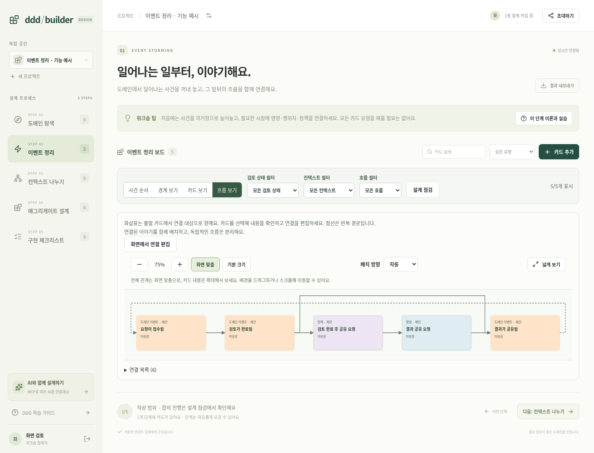
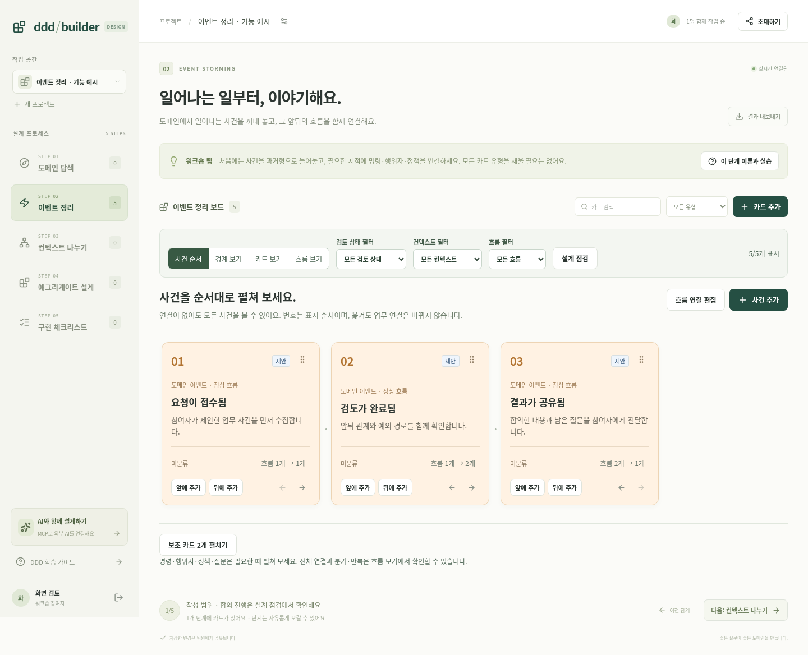
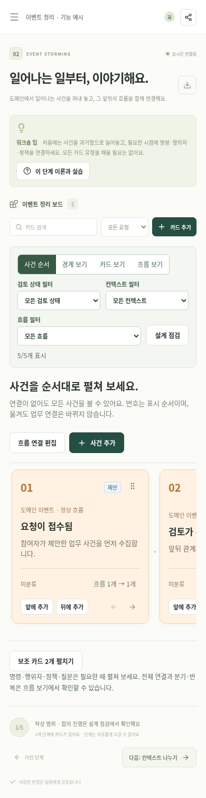

# 이벤트 정리: 사건 순서와 흐름 편집

이벤트 정리의 기본 화면은 **사건 순서**입니다. 사건을 먼저 수집하고 표시 순서를 정한 뒤 필요한 명령·행위자·정책과 연결합니다. 연결이 아직 없어도 사건을 모두 볼 수 있습니다. 기존 유형별 카드 보기와 컨텍스트 경계 보기, 흐름 보기도 유지합니다.

## 사건 수집과 순서 편집

- **사건 추가**는 이벤트 카드의 초안을 열고 저장 시 현재 사건 목록 끝에 추가합니다.
- 카드의 **앞에 추가 / 뒤에 추가**는 선택한 사건을 기준으로 초안을 엽니다. 컨텍스트와 정상·예외 구분은 기준 사건에서 초기값을 가져오며 저장 전에 편집할 수 있습니다. 위치를 정해도 업무 흐름을 자동 연결하지 않습니다.
- 오른쪽 위 이동 손잡이를 다른 카드의 왼쪽 또는 오른쪽에 드롭해 앞뒤 순서를 바꿉니다. 손잡이에 초점을 두고 **왼쪽·오른쪽 방향키**를 사용하거나 이동 버튼을 눌러도 됩니다. 표시 순서는 서버에 저장되고 다른 참여자와 새로고침 후에도 유지됩니다.
- 번호는 프로젝트 전체 이벤트의 표시 순서입니다. 검색·검토 상태·컨텍스트·정상/예외 필터로 일부 사건이 숨겨지면 순서 이동을 차단합니다. 기준 사건 앞뒤 삽입은 계속 사용할 수 있습니다.
- **보조 카드 펼치기**에서 명령·행위자·정책·질문을 확인하고 편집합니다. 비이벤트 유형으로 필터하면 해당 보조 카드를 자동 표시합니다.

순서 변경은 사건의 ID·설명·컨텍스트·시나리오·링크·합의 상태를 바꾸지 않습니다. 수정 버전과 변경 주체·시각은 저장에 맞춰 갱신합니다. 카드 번호와 위치는 업무의 필수 선행조건을 자동으로 증명하는 값이 아닙니다.

## 화면에서 흐름 연결

**흐름 연결 편집**을 열고 출발 카드와 대상을 선택한 뒤 추가합니다. 카드 아래의 흐름 수를 눌러 해당 사건의 연결을 확인할 수도 있습니다. 출발 카드의 나가는 연결 목록에서 원하는 흐름만 삭제합니다. 관련·선행 조건 등 다른 종류의 연결은 보존합니다.

**흐름 보기 → 화면에서 연결 편집**에서도 같은 작업을 제공합니다. 편집 모드에서 출발 카드와 대상 카드를 클릭하거나 선택 상자를 사용할 수 있습니다. 연결선은 마우스 클릭 또는 키보드 Enter/Space로 해당 관계를 엽니다. 조회자는 관계와 상세를 읽을 수 있지만 추가·삭제할 수 없습니다.

연결 전의 카드도 캔버스에 표시하고 점선 테두리로 구분합니다. 분기와 여러 입력이 모이는 관계는 실제 연결을 따라 배치하며, 반복 경로는 점선 화살표로 표시합니다. 필터 밖 대상은 안내로 표시하고 전체 관계는 필터를 해제해 확인합니다.

유효한 흐름은 기존과 같은 행위자 → 명령 → 이벤트 → 정책 → 명령, 또는 이벤트 → 이벤트입니다. 표시 위치만으로 이 관계를 추정하거나 저장하지 않습니다. 흐름 연결을 변경하면 기존 서버 규칙에 따라 합의된 출발 카드는 제안으로 돌아가 재검토합니다.

여러 선이 모인다고 모든 조건을 기다리는 AND인지 하나만 필요한 OR인지 자동 결정하지 않습니다. 구조화된 분기·합류 조건과 타임아웃은 후속 범위이며 현재는 정책·설명에 기록합니다. 이 화면은 워크숍 설계 도구이며 업무 프로세스를 실행하는 엔진이 아닙니다.



## 협업·권한·충돌

순서 저장은 드래그 시작 또는 버튼 선택 당시의 전체 이벤트 ID·버전을 서버에 전달합니다. 사건이 추가·삭제되거나 하나라도 수정되면 409로 거절하고 기존 상태를 보존합니다. 한 트랜잭션으로 저장하고 SSE로 공유하며, 버전을 올려 자동 재시도하지 않습니다.

앞뒤 삽입도 생성과 위치 조정을 한 트랜잭션으로 저장합니다. 기준 사건이 수정·삭제되면 초안은 유지하고, **최신 삽입 기준 확인** 또는 **끝에 추가로 변경**으로 작성자가 위치를 다시 선택합니다. 삽입 기준을 새 카드의 편집 대상으로 바꾸지 않습니다.

연결 편집은 선택한 출발 카드의 버전을 유지합니다. 동료의 변경이 도착하면 **최신 연결 불러오기**로 검토한 뒤 다시 편집합니다. 저장 중 출발 선택·닫기·다른 연결 조작을 차단합니다. 읽기 권한·연결 끊김에서는 순서 이동·삽입·연결 변경이 차단되고 서버도 프로젝트 권한과 버전을 검사합니다.

## API와 호환성

`POST /api/projects/:projectId/event-order`:

```json
{"cards":[{"id":"<첫 이벤트 ID>","revision":3},{"id":"<둘째 이벤트 ID>","revision":2}]}
```

현재 프로젝트의 `stage=events`, `kind=event` 전체 목록이 정확히 한 번씩 포함되어야 합니다. 프로젝트 편집 권한과 모든 현재 버전을 확인하고 숫자 `position`을 0부터 저장합니다. 응답은 `{cards: Card[]}`입니다. 다른 카드 유형의 위치와 내용은 유지합니다. 잘못된 본문은 400, 사건 집합·버전 충돌은 409이며 승인 전에 일부 순서를 저장하지 않습니다. 본문에는 기존 128 KiB 한도가 적용됩니다.

기존 카드 생성 `POST /api/projects/:projectId/cards`의 본문에 일회용 삽입 요청을 추가할 수 있습니다.

```json
{
  "stage":"events","kind":"event","title":"새 사건이 확인됨",
  "placement":{"anchorId":"<기준 이벤트 ID>","anchorRevision":4,"side":"after"}
}
```

`side`는 `before`/`after`, 끝 삽입은 `{"side":"end"}`입니다. 기준 사건은 같은 프로젝트의 현재 이벤트여야 합니다. `placement`는 저장된 카드·내보내기에 포함하지 않으며 새 업무 링크도 만들지 않습니다. 기존 생성·수정 계약과 MCP 도구, 숫자 위치와 카드·규칙 ID는 유지합니다. 기존 클라이언트가 삽입 요청 없이 지정하는 `position`도 계속 지원합니다.

## 검증

- Node 테스트 **109개 통과**: 순서 보존, 합의·링크·다른 유형 보존, 수정·추가·삭제 충돌의 원자적 거절, 앞뒤·끝 삽입, 입력 검증과 프로젝트·조회자·읽기 토큰 권한을 포함합니다.
- 전체 Playwright **37개 통과**: 기존 협업·MCP·인증·게스트 철회·설계 문서 기능과 새 화면 6개 시나리오를 포함합니다. 실제 브라우저의 드래그·방향키, 두 참여자의 동기화, 새로고침, 앞뒤 삽입, 직접 연결·분기·반복, 동료 수정 후 연결 재검토, 삭제된 기준의 초안 보존, 필터와 조회자 제한을 확인했습니다.
- TypeScript/Vite 빌드 성공. 데스크톱과 390px 모바일에서 문서 전체 가로 넘침 없이 사건 목록 내부에서 스크롤할 수 있습니다.

소스: `EventStoryBoard.tsx`, `FlowConnectionEditor.tsx`, `FlowBoard.tsx`, `CardEditor.tsx`, `server/app.mjs`. 테스트: `tests/event-order.test.mjs`, `tests/e2e/event-story.spec.ts`, 기존 인증·모델 테스트.




